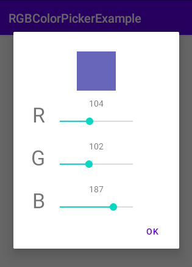

# rgbColorPickerDialog
Yet another simple color picker dialog

## Screen shot


## Usage
Add JitPack to the repositories in your `settings.gradle`:
```gradle
dependencyResolutionManagement {
    repositories {
        google()
        mavenCentral()
        maven { url "https://jitpack.io" }
    }
}
```
Then add the dependency to your app's `build.gradle`, replacing the placeholder
with a published tag or commit:
```gradle
dependencies {
    implementation 'com.github.twobartha:rgbColorPickerDialog:{version-or-commit}'
}
```

Use like this:

```kotlin
    val dialog = RGBColorPickerDialog.create(255, 0, 0)
    // val dialog = RGBColorPickerDialog.create(255, 0, 0, 255)         // Use this if you want to use alpha
    // val dialog = RGBColorPickerDialog.createWithHSV(255, 0, 0)       // Use this to show SeekBars for HSV
    // val dialog = RGBColorPickerDialog.createWithHSV(255, 0, 0, 255)  //  and to use alpha

    val listener: RGBColorPickerDialog.Listener = object : RGBColorPickerDialog.Listener {
        override fun onFinished(r: Int, g: Int, b: Int, a: Int) {
            // TODO: use values
        }
    }

    dialog.setOnFinishedListener(listener)
    dialog.show(supportFragmentManager, "dialog")
```

## Build requirements

The build uses the following pinned toolchain; it does not track the newest
release of every dependency:

| Component | Version |
| --- | --- |
| Build JDK | 17 |
| Gradle Wrapper | 8.13 |
| Android Gradle Plugin | 8.13.2 |
| Kotlin | 2.3.21 |
| Android compile SDK | 36 |
| Android SDK Build-Tools | 35.0.0 (AGP default) |

Install the SDK packages and accept their licenses using Android Studio's SDK
Manager or `sdkmanager`. Set `ANDROID_HOME` to the SDK directory, or set
`sdk.dir` in an untracked `local.properties` file. Use JDK 17 for `JAVA_HOME`
and for Android Studio's Gradle JDK.

The minimum supported device API remains 26 (Android 8.0). The library's JVM
bytecode target remains Java 11; the sample's remains Java 8. These are separate
from the JDK used to run Gradle.

## Build and verification

From the repository root on Linux/macOS:

```sh
bash ./gradlew clean :RGBColorPickerDialog:clean :example:clean \
    :RGBColorPickerDialog:assembleRelease :example:assembleDebug \
    :RGBColorPickerDialog:testDebugUnitTest :example:testDebugUnitTest \
    :RGBColorPickerDialog:lintDebug :example:lintDebug
```

On Windows, use `gradlew.bat` with the same tasks. Outputs include:

- Library: `RGBColorPickerDialog/build/outputs/aar/RGBColorPickerDialog-release.aar`
- Sample: `example/build/outputs/apk/debug/example-debug.apk`
- Lint: each module's `build/reports/lint-results-debug.html`

There are currently no unit or instrumentation test sources. Unit-test tasks
therefore report `NO-SOURCE`; this is not a passing behavioral test suite. Build
and lint checks do not replace testing the dialog on a device or emulator.

To generate the release AAR, POM, and Gradle module metadata and install them in
the local Maven repository:

```sh
bash ./gradlew :RGBColorPickerDialog:publishReleasePublicationToMavenLocal
```

The local coordinates remain `com.github.twobartha:rgbColorPickerDialog:1.0`.
This command replaces the existing local artifact at those coordinates, if any.
The root `jitpack.yml` selects JDK 17 and runs the same publication task. Local
publication does not verify a hosted JitPack build or publish a remote release.

## Compatibility notes for the build update

- The `create` / `createWithHSV` overloads and `Listener` API are unchanged,
  as are the Kotlin package and resource namespace (including capitalization).
  The dialog implementation and its own resources have not been changed.
- Consumers of the updated artifact should use compile SDK 36 or higher and a
  Kotlin compiler capable of reading Kotlin 2.3 metadata. Kotlin 2.3.21 with
  the toolchain above is the verified configuration; old Kotlin 1.6 builds are
  not a supported consumption configuration for this update.
- AndroidX and Material dependencies have been updated. Some resource names
  from older dependencies that were exposed through the transitive `R` class
  are no longer available, for example `R.dimen.mtrl_badge_radius`. Apps that
  referenced those names must migrate to resources supported by the updated
  dependency or define their own. Retaining transitive R classes does not
  restore resources removed upstream. This update does not promise unchanged
  dependency APIs, resource values, or widget rendering.
- The sample is not distributed on Google Play and deliberately retains
  `targetSdk 31`. Only the `ExpiredTargetSdkVersion` lint check is downgraded
  to a warning in both modules; other lint errors still fail the build. A
  consuming application's target SDK and Play requirements remain its own
  responsibility.
- AGP 8 omits the library target SDK from the generated AAR manifest. The
  sample's merged manifest still targets API 31 and both modules keep minSdk 26.
- The project retains the existing Maven coordinates and publication version.
  Choose an appropriate new release tag before distributing this update; do
  not treat it as a drop-in replacement for an already published artifact.
